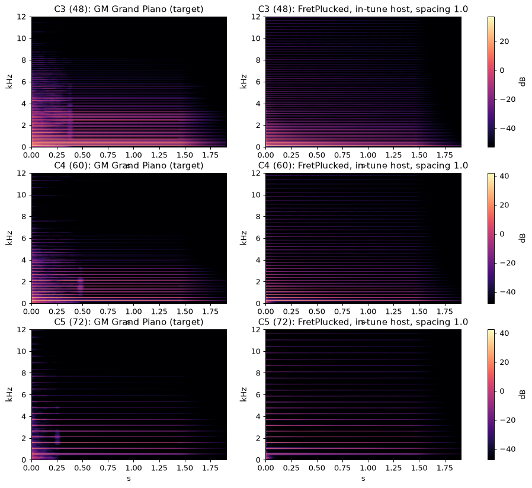

# PresetMaker

Makes presets for any VST3 instrument by listening. Pick a target sound (a General MIDI instrument
from Windows' built-in `gm.dls`, or a folder of your own sampled notes), and PresetMaker searches
the plugin's parameters until it sounds as close to the target as it can, then saves the result as
a `.vstpreset` where your DAW will find it.

It is best effort by design: an additive string synth will never be a distortion guitar, but it
will find the nearest thing it *can* do, and tell you how close it got.

PresetMaker is free. If it saved you an afternoon of knob-twiddling, you can
[buy Jeff a coffee](https://ko-fi.com/TideRack).



*gm.dls Acoustic Grand Piano (top) and the fitted preset for a VSTi plugin instrument ("FretPlucked", bottom) at C3, C4, C5.*

**Hear the results:** [five fitted presets next to the instruments they were fitted to](https://jeffmcclintock.github.io/PresetMaker/examples/FretPlucked/audio/),
playing in the browser. The presets themselves are in [`examples/FretPlucked/`](examples/FretPlucked/).

## Get started

1. Download `PresetMaker-windows.zip` from [Releases](https://github.com/JeffMcClintock/PresetMaker/releases)
   and unzip it anywhere. Windows 10 or later; nothing to install.
2. Run `PresetMaker.exe`.
3. **Plugin**: browse to the instrument's `.vst3` (usually under `C:\Program Files\Common Files\VST3`).
4. **Target**: choose a GM instrument from the list, or point **Sample folder** at WAVs of your own.
5. **Preset name**: what the preset will be called in your DAW.
6. Press **Fit**. The bar fills as it works; a fit is 600 renders and takes a few minutes to half
   an hour depending on the plugin. When it says FINISHED, the preset is in
   `Documents\VST3 Presets\<Vendor>\<Plugin>\` (the **Presets…** button opens that folder) and
   your DAW's preset browser will list it next time you open the plugin.

Also in the output folder: `fit_*.wav` and `ref_*.wav`, the fitted plugin and the target playing
the same notes, so you can hear how close it got.

Tick **All 128 GM programs** and **Fit all** makes a preset for every General MIDI instrument,
named after it, several at a time. Budget an hour or two.

The **Parameters** tab lists the plugin's parameters, each with its index and an *ignore* tick: a ticked one is
left at its current value and not searched. Tuning controls are ticked for you, so the fit cannot
drift out of tune. Leave the rest the first time.

## Command line

`pmcli.exe` does the same from a prompt, and can run many fits at once:

```
pmcli gm-list
pmcli vst-params "C:\Program Files\Common Files\VST3\MySynth.vst3"
pmcli fit "C:\Program Files\Common Files\VST3\MySynth.vst3" 24 out\nylon --name "Nylon Guitar" --check
pmcli fit-batch MySynth.vst3 examples\FretPlucked\gm_strings.txt out --jobs 8
```

`gm-list` prints the 128 GM programs (0 = Acoustic Grand Piano, 24 = Nylon Guitar, 40 = Violin
...). `vst-params` lists the plugin's parameters and which the search will move. `fit` fits GM 24
at C3, C4 and C5 and, with `--check`, tests the preset on notes it never saw. `fit-batch` takes a
file of `reference<TAB>Preset Name` lines and runs them `--jobs` at a time.

## Example: a VSTi plugin instrument ("FretPlucked")

`examples/FretPlucked/` holds twenty presets fitted for FretPlucked, a VSTi plugin instrument
(SynthEdit's additive plucked-string oscillator): the `gm_strings.txt` batch list, each result as `preset.txt`, and the `.vstpreset`
files. `tools/populate_presets.py` wrote them into the SynthEdit project's preset slots;
`tools/spectro.py` draws comparison spectrograms like the one above.

### Hear it

Five of the presets playing the same short tune as the gm.dls instrument they were fitted to
(target: the Windows General MIDI sample; fitted: the VSTi plugin with the preset PresetMaker found),
rendered by `tools/demo_tunes.py` (16-bit 48 kHz mono, 6.5 s, both files normalised to the same
peak). **[Play them in the browser](https://jeffmcclintock.github.io/PresetMaker/examples/FretPlucked/audio/)**,
or download the files below (GitHub does not play WAV inline). The score is the held-out
similarity from `--check` (notes the fit never saw).

| instrument | gm.dls target | VSTi plugin fitted | held-out |
|---|---|---|---|
| Acoustic Grand Piano | [target](examples/FretPlucked/audio/acoustic_grand_piano_target.wav) | [fitted](examples/FretPlucked/audio/acoustic_grand_piano_fitted.wav) | 34.1% |
| Harpsichord | [target](examples/FretPlucked/audio/harpsichord_target.wav) | [fitted](examples/FretPlucked/audio/harpsichord_fitted.wav) | 34.1% |
| Nylon Guitar | [target](examples/FretPlucked/audio/nylon_guitar_target.wav) | [fitted](examples/FretPlucked/audio/nylon_guitar_fitted.wav) | 34.3% |
| Acoustic Bass | [target](examples/FretPlucked/audio/acoustic_bass_target.wav) | [fitted](examples/FretPlucked/audio/acoustic_bass_fitted.wav) | 29.3% |
| Harp | [target](examples/FretPlucked/audio/harp_target.wav) | [fitted](examples/FretPlucked/audio/harp_fitted.wav) | 30.6% |

## Tips

- **Volume is free.** Overall gain is fitted out of the score, so a master volume costs the search
  nothing; hold one only if you want the preset at a particular level (`--fix "Volume=0.3"`).
- **Listen, and check the pitch.** The score compares loudness in auditory bands, which hears
  timbre and envelope well but is nearly deaf to harmonicity: a plugin whose partials are stretched
  can score well and sound wrong. If the fit keeps pushing a tuning or spacing parameter away from
  neutral, hold it.
- **Octaves are handled.** A target that sounds an octave below (or above) where the plugin plays
  the same key, as the GM organs do, is played an octave up so the two can meet. The pitch of each
  training note is compared with the plugin's and, when every note agrees on a whole octave, a
  short trial decides. The log and the GUI say when it happened; the preset carries no offset,
  so the fitted sound sits where the plugin plays it. `--transpose 0` turns this off.
- **Expect a ceiling.** Around 35% similarity on the held-out notes is a good fit for a sound the
  plugin can genuinely make; under 20% means the target is outside what it can do (distorted,
  bowed, or an attack it has no model for), and no budget will change that.
- **Pre-roll.** If results sound like the *previous* parameters, the plugin builds tables in the
  background; raise the pre-roll (0.25 s works for SynthEdit plugins).
- **Polish a result** by fitting again from it: `--start out\x\preset.txt --evals 400`.

## Reference sounds

| | |
|---|---|
| `24` or `gm:24` | GM program 24 from gm.dls (Windows only) |
| `C:\samples\piano\` | a folder of WAVs named `<key>.wav` or `<key>_<velocity>.wav` (MIDI key numbers, e.g. `60_100.wav`); the nearest sample is resampled to pitch like a sampler |
| `note.wav` | one WAV used for every note (resampled) |

The target can be anything you can record: a real instrument, a hardware synth, another plugin.

## Command-line options

| | default | |
|---|---|---|
| `--evals N` | 1200 | renders per fit; the search stops here |
| `--keys 48,60,72` `--vel 100` | | the notes fitted (all keys at once; a preset must serve all of them) |
| `--hold 1.5` `--tail 0.5` | | note length and release tail, seconds |
| `--fix "Volume=0.3;Pan=0.5"` | | parameters held at a normalised value and left out of the search; `#17=0.3` names one by its index when titles repeat (the index as `vst-params` and the Parameters tab show it) |
| `--skip "LFO;Reverb"` | MIDI CC etc. | parameters whose title contains the text are left out, at their plugin value |
| `--start preset.txt` `--sigma 0.05` | | continue from an earlier result with a small step instead of starting cold |
| `--preroll 0.25` | 0.15 | seconds of silence rendered before each note |
| `--name "X"` `--preset-dir D` `--no-vstpreset` | | the `.vstpreset`: its name, somewhere other than the standard folder, or none |
| `--check` | | held-out test after the fit (G2, G3, G4, G5, and C4 soft and loud) |
| `--delta 0.3` | | weight of the spectral-change term in the score (see below) |
| `--transpose N` | auto | play the target N semitones up; auto detects whole octaves (see Tips) |
| `--seed N` | 7 | the random start; another seed gives a different search path |

Other commands: `gm-render <ref> <key> <vel> out.wav`, `vst-render <plugin> <key> <vel> out.wav
["Title=0.5" ...]`, `score ref.wav cand.wav`, `check <plugin> <ref> preset.txt`, `export <plugin>
preset.txt "Name"` (a `.vstpreset` from a `preset.txt`).

Parameters the plugin marks non-automatable, hidden or read-only are never touched, nor are MIDI
controller parameters (SynthEdit exposes 178 of them; sending them 0 bends the pitch).

## How it works

Each render and its target are analysed in 40 ERB-spaced auditory bands at two time resolutions,
converted to loudness with a threshold-in-quiet and a compressive (Zwicker) law so that quiet
detail counts for less than loud detail, and compared on: the fine time-frequency surface, the
tonal (long-window) spectrum, the per-band envelope, and the per-band *change* over 50 ms (which
is what makes the fit care about how partials decay, not just how loud they are). The first 60 ms
after note-on are weighted up. The candidate's gain is fitted out, so level is never the issue.
The envelope is also compared as a handful of features read from the broadband level: attack, decay
and release times, sustain level, and tremolo rate and depth (the strongest ripple between 0.5 and
15 Hz on the held part). When the target has tremolo, the time-frequency surfaces are smoothed
over one tremolo period before comparison, so the fit is judged on the rate and depth of the
wobble rather than on landing in phase with it. `pmcli score` prints both sides' features.
Similarity = 100·exp(−3·distance). `pmcal` (built alongside) runs the calibration tests the
weights were chosen against: identity (same program, different velocity must rank first of 128),
family retrieval, and monotonic degradation.

The search is separable CMA-ES on the unit cube; a cold start samples 10% of the budget at random
to find the right region first. Stepped parameters are quantised. The plugin is hosted with the
VST3 SDK's own hosting classes and rendered offline, faster than real time where the plugin
allows it.

## Building

Windows, Visual Studio 2022 or later:

```
cmake -S . -B build -DPM_GUI=ON
cmake --build build --config Release
```

The VST3 SDK is fetched from GitHub (or found in an existing `~/.cpm` cache). `-DPM_GUI=ON` also
builds `PresetMaker.exe`, a small [gmpi_ui](https://github.com/JeffMcClintock/gmpi_ui) desktop
app, fetching gmpi_ui and GMPI; leave it off for the command line alone.

Source layout: `Dls`/`GmRender` (DLS reader and offline note player), `Reference` (target
sources), `Vst3Host` (SDK hosting, offline rendering, `.vstpreset` writing), `Metrics` (the
score), `Cma.h`, `Fit` (the search; shared by `cli.cpp` and `gui/`), `calibrate.cpp` (`pmcal`).
